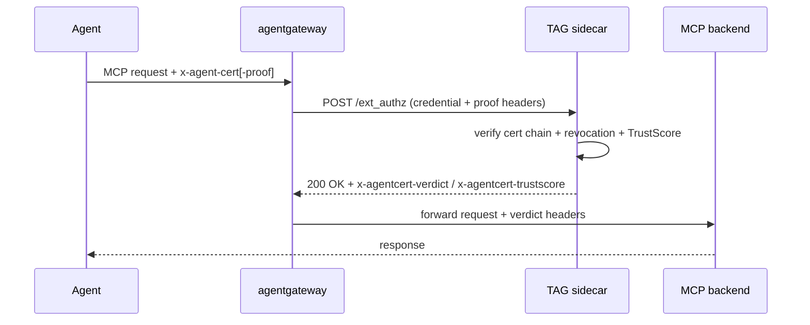

# AgentCert + TrustScore verification for agentgateway

Verify a calling agent's **[AgentCert](https://trustmodel.ai/agentcert)** and live
**TrustScore** on every MCP request through agentgateway — with no plugin code in
the gateway itself.

agentgateway's `extAuthz` policy calls the
[TAG (Trusted Agent Gateway) verify sidecar](https://github.com/pdxlab/agentcert-tag)
over HTTP. The sidecar handles certificate chain validation, revocation checking,
and trust-score enforcement, then returns `200` (allow) or `403` (deny) plus
`x-agentcert-*` verdict headers that agentgateway copies onto the upstream request.

This approach was confirmed by the agentgateway maintainer in
[#3573](https://github.com/agentgateway/agentgateway/issues/3573):
> agentgateway supports ext_authz, so there wouldn't need to be code in agentgateway itself.



## Quickstart

```bash
# 1. Get a TrustModel anchor bundle (the cert roots the sidecar trusts)
mkdir anchors
curl -sO https://trustmodel.ai/agentcert/anchors.pem -o anchors/roots.pem

# 2. Start agentgateway + TAG sidecar in shadow mode
docker compose up

# 3. Send a test MCP request (no cert required in shadow mode)
curl http://localhost:3000/mcp \
  -H "Content-Type: application/json" \
  -d '{"jsonrpc":"2.0","method":"tools/list","id":1}'

# 4. Watch what shadow mode would block
docker compose logs tag-sidecar | grep shadow-would
```

## Configuration

See [`config.yaml`](./config.yaml) for the full agentgateway configuration.
The key section is:

```yaml
mcp:
  policies:
    extAuthz:
      host: tag-sidecar:8080
      protocol:
        http:
          path: '"/ext_authz"'
          includeRequestHeaders:
            - x-agent-cert
            - x-agent-cert-proof
            - x-agent-cert-carriage
            - x-agent-id
          includeResponseHeaders:
            - x-agentcert-verdict
            - x-agentcert-trustscore
            - x-agentcert-tier
            - x-agentcert-decision
            - x-agentcert-shadow-would
      failureMode:
        denyWithStatus: 503
```

## Rollout

**Step 1 — Shadow (default).** `TAG_MODE=shadow` on the sidecar. It logs every
decision but returns `200` on everything — zero request impact. Watch
`x-agentcert-shadow-would` to see what enforce *would* block.

**Step 2 — Enforce.** Set `TAG_MODE=enforce` on the sidecar (optionally
`TAG_MIN_SCORE=N` for a minimum TrustScore threshold, 0-100). Agents without a
valid cert, or with a score below the floor, receive `403`.

## Verdict headers

| Header | Value |
|--------|-------|
| `x-agentcert-verdict` | `VERIFIED` \| `UNVERIFIED` \| `EXPIRED` \| `REVOKED` \| `ERROR` |
| `x-agentcert-agent-id` | ANS agent identifier |
| `x-agentcert-trustscore` | 0-100 live TrustScore, empty if unverified |
| `x-agentcert-tier` | `Preliminary` \| `Verified` \| `Monitored` |
| `x-agentcert-decision` | `allow` \| `deny` |
| `x-agentcert-shadow-would` | `allow` \| `deny` (shadow mode only) |

## Resources

- [TAG repository](https://github.com/pdxlab/agentcert-tag) — sidecar source, Kong plugin, SDK middleware
- [AgentCert documentation](https://trustmodel.ai/agentcert)
- [TrustModel developer portal](https://trustmodel.ai/developers)
- [ext_authz contract](https://github.com/pdxlab/agentcert-tag/blob/main/docs/ext_authz.md)
